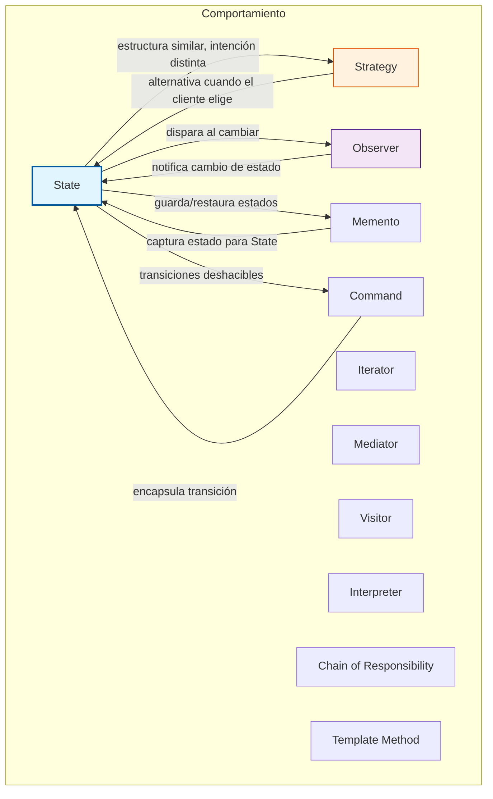

# Grafo de relaciones entre patrones de comportamiento

Diagrama Mermaid. Úsalo para visualizar cómo se conecta State con el resto.

## Cómo leerlo

- **State (A)** es el nodo central de esta sesión.
- Su relación más fuerte es con **Strategy (B)**: comparten estructura, difieren en quién decide.
- Se conecta con **Observer (C)** si necesitas avisar a otros módulos al cambiar de estado.
- Se conecta con **Memento (E)** y **Command (D)** si necesitas historial o deshacer.
